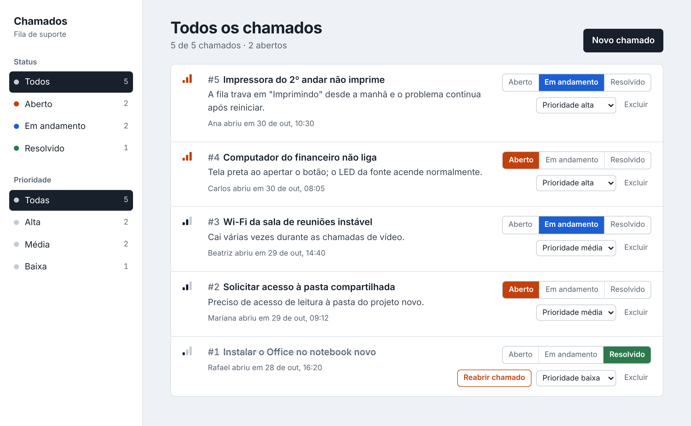

<h1 align="center">Controle de Chamados</h1>

<p align="center">
  Sistema para registrar e acompanhar pedidos de suporte, com API REST em Flask, banco SQLite e interface web.
</p>

<p align="center">
  
  
  
  
  
  
</p>

<p align="center">
  
</p>

<p align="center"><sub>Captura de tela com chamados de exemplo.</sub></p>

## Funcionalidades

- **Cadastro de chamados** com título, descrição, solicitante e prioridade (título e solicitante são obrigatórios).
- **Acompanhamento por status:** aberto, em andamento e resolvido.
- **Prioridades** baixa, média e alta (padrão: média). A lista vem da mais urgente para a menos urgente e, dentro de cada prioridade, do mais recente para o mais antigo.
- **Filtros** por status e por prioridade, que podem ser combinados, com contadores na barra lateral.
- **Reabertura** de chamados resolvidos.
- **Exclusão** com confirmação.
- **Persistência em SQLite:** o banco é criado automaticamente e bancos antigos, sem a coluna de prioridade, são migrados sozinhos.
- **Interface responsiva**, com o texto digitado escapado para evitar injeção de HTML.
- **Testes automatizados** da API.

## Tecnologias

| Camada      | Tecnologias                       |
|-------------|-----------------------------------|
| Back-end    | Python, Flask                     |
| Banco       | SQLite                            |
| Front-end   | HTML, CSS e JavaScript (sem frameworks) |
| Testes      | `unittest`                        |

## Como executar

Pré-requisito: Python 3 instalado.

```bash
git clone https://github.com/g-alencar06/controle-de-chamados-full.git
cd controle-de-chamados-full

# (opcional) ambiente virtual
python -m venv venv
# Windows:      venv\Scripts\activate
# Linux/macOS:  source venv/bin/activate

pip install -r requirements.txt
python app.py
```

Abra http://127.0.0.1:5000 no navegador. O arquivo `chamados.db` é criado automaticamente na primeira execução e os dados permanecem após reiniciar.

## Testes

```bash
python -m unittest -v
```

## API

| Método | Rota                              | Descrição                                                         |
|--------|-----------------------------------|-------------------------------------------------------------------|
| `GET`    | `/api/chamados`                 | Lista os chamados, ordenados por prioridade                       |
| `GET`    | `/api/chamados?status=aberto`   | Filtra por status (`aberto`, `em andamento`, `resolvido`)         |
| `GET`    | `/api/chamados?prioridade=alta` | Filtra por prioridade (`baixa`, `media`, `alta`); combina com `status` |
| `POST`   | `/api/chamados`                 | Cria um chamado (`titulo` e `solicitante` obrigatórios; `descricao` e `prioridade` opcionais) |
| `PATCH`  | `/api/chamados/<id>/status`     | Altera o status                                                   |
| `PATCH`  | `/api/chamados/<id>/prioridade` | Altera a prioridade                                               |
| `POST`   | `/api/chamados/<id>/reabrir`    | Reabre um chamado resolvido (`409` se ele não estiver resolvido)  |
| `DELETE` | `/api/chamados/<id>`            | Exclui o chamado (`204`; `404` se não existir)                    |

Exemplo:

```bash
curl -X POST http://127.0.0.1:5000/api/chamados \
  -H "Content-Type: application/json" \
  -d '{"titulo": "Instalar o Office no notebook novo", "solicitante": "Rafael", "prioridade": "baixa"}'
```

```json
{
  "criado_em": "2026-10-30 22:52:37",
  "descricao": "",
  "id": 1,
  "prioridade": "baixa",
  "solicitante": "Rafael",
  "status": "aberto",
  "titulo": "Instalar o Office no notebook novo"
}
```

Erros de validação retornam `400` com uma mensagem no formato `{"erro": "..."}`.

## Estrutura do projeto

```
controle-de-chamados-full/
├── app.py             # API REST (Flask) e acesso ao SQLite
├── static/
│   └── index.html     # Interface web (HTML, CSS e JavaScript)
├── test_app.py        # Testes automatizados
├── requirements.txt   # Dependências
└── docs/
    └── screenshot.png # Captura de tela usada neste README
```

## Observações

O servidor usa o modo de desenvolvimento do Flask e a aplicação não tem autenticação, por isso é indicada para uso local.

## Autor

Feito por **Gabriel Alves**, estudante de Análise e Desenvolvimento de Sistemas.

[](https://www.linkedin.com/in/gabriel-alves-0bb808438/)
[](https://github.com/g-alencar06)
